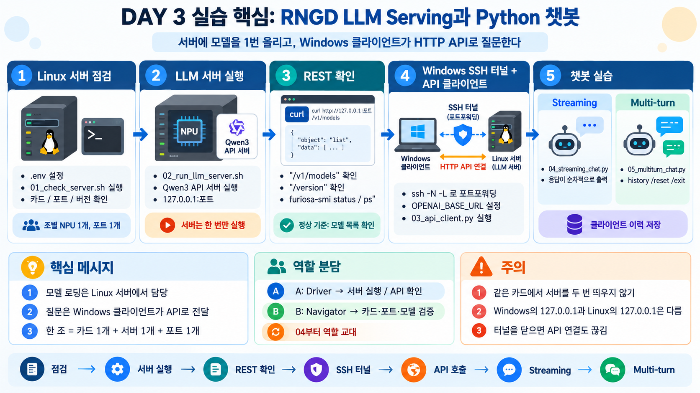
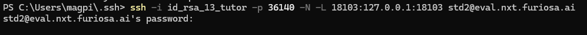

# DAY 3 실습: RNGD LLM Serving과 Python 챗봇

## 실습 내용



## 목적과 실행 위치

DAY 2의 `LLM.chat()`은 Python 프로세스가 모델을 직접 로딩했다. 오늘은 Linux 서버 프로세스가 조별 RNGD 카드에 모델을 한 번 올리고, Windows Python 클라이언트가 HTTP API로 질문한다. 각 조는 카드 1개와 SSH 계정 1개를 공유한다. 서버를 두 번 띄우지 않는다.

| 파일 | 실행 위치 | 목적 |
|---|---|---|
| `01_check_server.sh` | Linux SSH | Driver/SDK, 카드 점유, CLI 옵션, 포트 확인 |
| `02_run_llm_server.sh` | Linux SSH | 조별 카드의 Qwen3 API 서버 실행 |
| `03_api_client.py` | Windows PowerShell | 모델 목록과 일반 Chat Completion 확인 |
| `04_streaming_chat.py` | Windows PowerShell | Single-turn Streaming 챗봇 |
| `05_multiturn_chat.py` | Windows PowerShell | 클라이언트 이력·초기화 기능이 있는 챗봇 |
| `requirements.txt` | Windows PC | OpenAI SDK와 dotenv 설치 |
| `.env.example` | Linux/Windows 각각 복사 | 장치·포트·API URL 설정 예시 |

## 사전 준비

1. DAY 1 배정표의 Device/PCI-BDF와 `furiosa-smi info/status/ps`를 대조한다. 각 조에 **독립 카드 1개와 겹치지 않는 서버 포트 1개**를 배정한다.
2. DAY 2의 Python 추론 및 다른 Serving 프로세스가 조별 카드를 점유하지 않는지 확인한다.
3. 서버의 Python, `furiosa-llm` 버전, `furiosa-llm serve --help` 옵션, Qwen3-8B-FP8 모델과 FXB 캐시, 디스크·네트워크 상태를 실제 서버에서 확인한다. 코드는 Furiosa SDK 2026.4 문서 API를 기준으로 작성되었으며 설치 버전에서의 동작은 별도 확인이 필요하다.
4. Windows PC의 Python/`openai`/`python-dotenv` 설치 가능 여부와 SSH 포트 포워딩 정책을 확인한다.
5. 실습 폴더는 서버와 Windows PC 양쪽에 복사한다. `.env`는 각각 현장 값으로 설정한다. 비밀번호나 개인키를 넣지 않는다.

## 1단계: Linux 서버의 조별 설정

Windows의 VS Code Remote SSH 또는 PowerShell에서 조별 SSH 계정으로 접속한다. **아래 명령은 Linux SSH 터미널에서** 실행한다.

```bash
cd DAY03_practice
cp .env.example .env
# 편집기로 TEAM_NPU_DEVICE=npu:X, TEAM_SERVER_PORT=강사배정포트 설정
source .env
bash 01_check_server.sh
```

`.env.example`의 `npu:__`와 `18___`는 실행 가능한 값이 아니다. 예를 들어 강사가 `npu:3`과 서버 포트 `18103`을 배정했다면 해당 조에서만 그 값을 사용한다. 장치 번호를 임의로 고르지 말고 DAY 1 PCI-BDF 기록과 현재 `furiosa-smi` 출력을 대조한다.

**예상 출력 형식:** 모델·장치·포트, Python과 furiosa-llm 버전, `furiosa-smi`의 장치 표, “Serving 옵션 확인: 통과”, “포트 …: 사용 가능”. 숫자와 점유 상태는 실제 서버마다 다르다. `furiosa-smi ps`에 본인 카드의 기존 추론 프로세스가 보이면 서버를 실행하지 않고 해당 조와 강사에게 확인한다.

## 2단계: 서버 실행과 REST 확인

Linux SSH 터미널 A에서 실행하고 터미널을 유지한다.

```bash
source .env
bash 02_run_llm_server.sh
```

스크립트는 `furiosa-llm serve MODEL_ID --devices npu:X --host 127.0.0.1 --port 포트 --reasoning-parser qwen3 --default-chat-template-kwargs '{"enable_thinking": false}'`를 실행한다. `127.0.0.1`은 **Linux 서버 자신**의 루프백 주소다. 모델 로딩 중에는 API가 아직 준비되지 않을 수 있다. 준비 완료 후 서버 로그에 Uvicorn 실행 주소가 나타난다. 실제 로그 문구는 버전에 따라 다르다.

Linux SSH 터미널 B에서 다음을 확인한다.

```bash
source .env
curl -fsS "http://127.0.0.1:${TEAM_SERVER_PORT}/v1/models"
curl -fsS "http://127.0.0.1:${TEAM_SERVER_PORT}/version"
furiosa-smi status
furiosa-smi ps
```

**정상 기준:** `/v1/models`의 `data`에 `furiosa-ai/Qwen3-8B-FP8`이 있고 `/version`은 서버 버전 정보를 돌려준다. 조별 카드는 서버 프로세스가 점유한다. 서버 종료는 터미널 A에서 `Ctrl+C`로 한다. 종료 후 `furiosa-smi ps`에서 본인 서버 프로세스가 사라졌는지 확인한다. 다른 조의 프로세스를 강제로 종료하지 않는다.

## 3단계: Windows PC에서 SSH 터널 연결

Windows의 `127.0.0.1`은 Windows PC 자신이다. Linux 서버의 `127.0.0.1`에 직접 연결되지 않는다. 별도 **Windows PowerShell 터미널 C**에서 포트 포워딩을 유지한다.

```powershell
# ssh -i 자신의ssh_key -p 자산의port -N -L 18103:127.0.0.1:18103 std2@eval.nxt.furiosa.ai
ssh -i id_rsa_2 -p 36030 -N -L 18103:127.0.0.1:18103 std1@eval.nxt.furiosa.ai
```


첫 번째 `18103`은 Windows PC에서 열 로컬 포트, 두 번째 `18103`은 Linux 서버에서 실행한 포트다. 자신의 조에 배정된 값으로 둘 다 바꾼다. 서버 SSH 접속 포트가 기본 22가 아니면 강사가 알려준 `-p SSH포트`를 추가한다. 터널 명령은 정상적으로 연결되어도 화면에 계속 머무를 수 있다. 이 터미널을 닫으면 API 연결도 끊긴다. 각자의 Windows PC에서는 같은 로컬 포트를 사용할 수 있지만, **한 PC에서 이미 사용 중인 로컬 포트와는 충돌하면 안 된다**.

Windows PowerShell 터미널 D에서 실습 폴더로 이동해 `.env`를 만들고 `OPENAI_BASE_URL=http://127.0.0.1:18103/v1`을 자신의 로컬 터널 포트에 맞춘다. `OPENAI_API_KEY=EMPTY`는 인증을 사용하지 않는 교육용 서버에서 SDK가 요구하는 자리표시자이며 비밀키가 아니다. 별도 인증이 설정된 환경에서는 강사가 제공한 안전한 방법으로 환경변수를 주입한다.

```powershell
클로드 도움을 받아서 윈도우 가상환경으로 변경한다.
uv sync
```

## 4단계: API와 Streaming 확인

`03_api_client.py`는 `client.models.list()`로 실제 로딩 모델을 확인하고 `client.chat.completions.create()`로 system/user 메시지를 보낸다. 정상 결과는 **모델 목록 → 질문 → 비어 있지 않은 응답**이다. 실제 문장과 지연시간은 고정되지 않는다. 모델 목록이 다르면 추론을 계속하지 말고 서버 모델과 `.env`를 대조한다.

```powershell
python 04_streaming_chat.py
```

예상 상호작용의 **형태**는 아래와 같다. 문장은 예시일 뿐 실제 모델 출력이 아니다.

```text
Single-turn Streaming 챗봇. 종료: /exit
나> NPU를 한 문장으로 설명해줘.
봇> [실제 생성 문장이 순차적으로 표시됨]
나> /exit
```

`stream=True`가 응답을 여러 **텍스트 조각**으로 보내며, 조각 하나가 반드시 토큰 하나는 아니다. `chunk.choices[0].delta.content`가 비어 있는 경우도 있으므로 건너뛴다. 이 파일은 질문마다 system과 현재 user만 보내므로 앞선 질문을 기억하지 않는 Single-turn이다.

## 5단계: Multi-turn과 조별 미션

```powershell
python 05_multiturn_chat.py
```

예상 상호작용의 **형태**:

```text
Multi-turn Streaming 챗봇. 초기화: /reset, 종료: /exit
나> 내 실습 주제는 RNGD야. 기억해줘.
봇> [실제 응답]
대화 턴: 1
나> 내 실습 주제가 무엇이었지?
봇> [앞선 질문을 참고한 실제 응답]
대화 턴: 2
나> /reset
대화 이력을 초기화했다.
나> /exit
```

`history`는 Windows Python 프로세스의 메모리에 있다. 요청마다 이전 user/assistant 메시지를 다시 보낸다. 서버가 모든 채팅 이력을 자동 저장한다고 가정하지 않는다. `/reset`은 system 메시지만 남겨 앞선 문맥을 버리고, `/exit`는 프로그램을 끝낸다. 응답이 비면 해당 턴을 이력에 추가하지 않는다.

**2인 1조 미션:** A는 Driver로 서버 실행과 03 API 확인을 수행하고 B는 Navigator로 카드·포트·모델 목록을 검증한다. 04부터 역할을 교대하여 B가 코드를 실행·수정하고 A가 기록·검증한다. 같은 SSH 계정과 카드에서 서버는 하나만 실행한다. 두 학생의 Windows 터널은 각각 별도 PC에서 연다.

**응용 과제:** 03의 system prompt를 “두 문장 이내로 답하라”로 바꾸고 응답 형식을 비교한다. 05에서 `/reset` 전후 같은 후속 질문을 실행해 이력 효과를 설명한다. 여유가 있으면 04의 `max_tokens`만 바꾸어 출력 길이의 상한이 어떻게 달라지는지 관찰한다. 한 번의 출력으로 품질·성능 우열을 단정하지 않는다.

## 오류 해결

| 증상 | 확인과 해결 |
|---|---|
| `npu:X`가 다름 | DAY 1 Device/PCI-BDF 배정표와 `furiosa-smi info`를 재대조한다. |
| `furiosa-llm serve --help` 옵션 없음 | 설치 SDK 버전과 2026.4 문서를 강사가 대조한다. 임의로 다른 옵션을 추측하지 않는다. |
| NPU 메모리 부족·device busy | DAY 2 Python 추론이나 중복 서버가 남았는지 `furiosa-smi ps`로 확인한다. |
| 포트 사용 중 | 같은 Linux 서버의 조별 포트 중복 여부를 확인하고 강사가 새 포트를 배정한다. |
| 모델/FXB 오류 | 모델 접근, 캐시·저장 공간, SDK·FXB 호환성을 강사가 확인한다. |
| Linux `curl` 연결 거부 | 모델 준비 완료 로그, 정확한 포트, 서버 프로세스 생존 여부를 확인한다. |
| Windows 연결 거부 | 터널 C가 실행 중인지, `-L` 양쪽 포트와 `.env` URL이 일치하는지 확인한다. |
| `401` | 서버 인증 정책과 `.env`의 키 제공 방식을 강사에게 확인한다. |
| 모델 목록 불일치 | 서버가 올린 모델과 `MODEL_ID`를 비교한다. |
| 응답이 비거나 끊김 | 서버 로그, thinking 설정, 네트워크·터널, `max_tokens`를 확인한다. |
| 문맥 길이 오류 | `/reset` 후 짧은 대화로 재시도한다. 대화 이력은 요청마다 길어진다. |

## DAY 4에 인계할 기록

조 번호, 카드 Device/PCI-BDF, 서버 포트, SDK/OpenAI SDK 버전, 모델 ID, 일반 응답/Streaming/Multi-turn 성공 여부, 오류와 조치, 종료 전후 `furiosa-smi` 상태를 기록한다. DAY 4에서는 같은 API를 이용해 요청 수, 응답 지연시간, Streaming의 첫 출력 시간 등을 측정한다. 오늘의 단발 관찰을 성능 결과로 보고하지 않는다.

## 공식 근거

- [FuriosaAI Qwen3 dense 모델](https://developer.furiosa.ai/latest/en/furiosa_llm/models/qwen3.html)
- [Furiosa-LLM OpenAI-Compatible Server](https://developer.furiosa.ai/latest/en/furiosa_llm/furiosa-llm-serve.html)
- [Furiosa-LLM Quick Start](https://developer.furiosa.ai/v2026.4.0/en/get_started/furiosa_llm.html)
- [OpenAI Python SDK](https://github.com/openai/openai-python)
