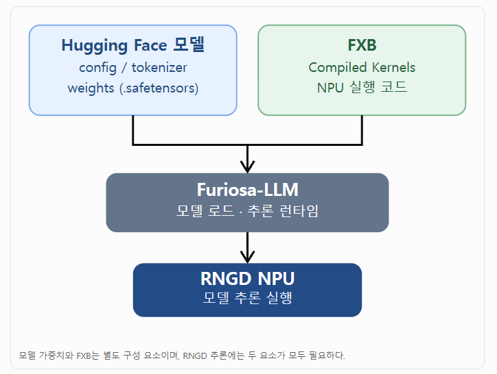
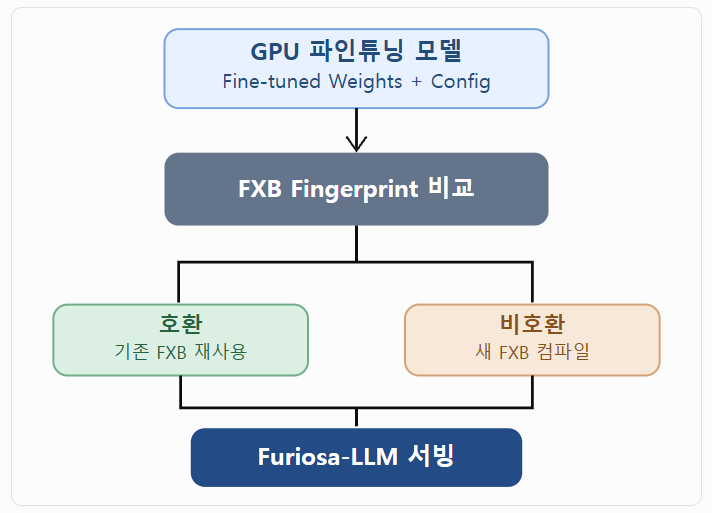
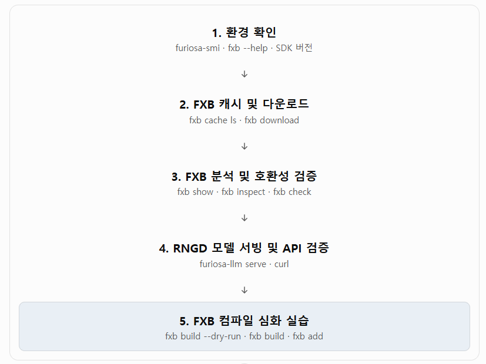
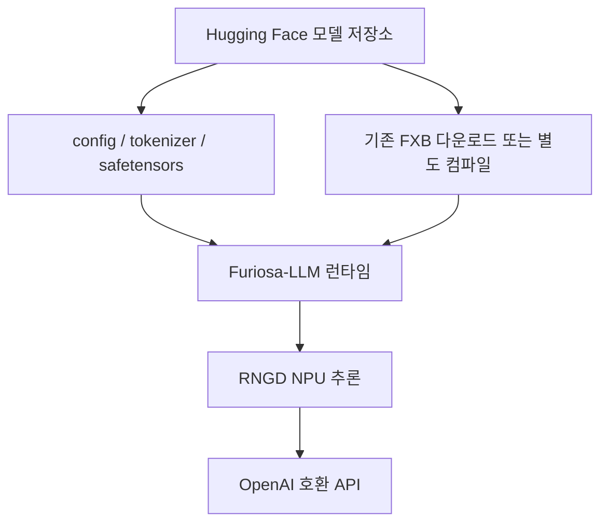

# Furiosa FXB CLI 실습 교재
##  0. FXB 소개
### FXB란?
Furiosa Executable Bundle을 생성·다운로드·관리하는 CLI 도구
### FXB의 역할과 전체 구조


### 파인튜닝 모델에 FXB를 재사용하는 방법

기존 모델과 파인튜닝 모델의 아키텍처 및 커널 생성 관련 config.json 값이 같다면 기존 FXB를 재사용할 수 있다. 반대로 아키텍처, attention 설정, quantization format 등 fingerprint에 영향을 주는 구성이 바뀌면 새 FXB 컴파일이 필요하다.

특히 모델을 BF16에서 FP8로 변경했다면 동일한 FXB를 그대로 재사용할 수 있다고 가정해서는 안 된다. 양자화 형식은 호환성 판정 요소에 포함된다.

### 실습 환경 
> **실습 환경**: Ubuntu Linux · Furiosa RNGD NPU 1개/조 · 학생 2인 1조 · Furiosa SDK 2026.4.0 기준  

> **대상**: Hugging Face 모델, Linux CLI, LLM 추론 서버의 기초 개념을 이해한 학습자



## 1. 학습 목표와 완료 기준

이 실습을 마치면 다음 작업을 수행하고 결과를 설명할 수 있다.

1. 모델 **가중치(weights)**와 **FXB(컴파일된 NPU 실행 번들)**의 차이를 설명한다.
2. `fxb` CLI로 캐시를 조회하고 공개된 FXB를 다운로드한다.
3. `fxb show`, `fxb inspect`, `fxb check`로 메타데이터와 호환성을 확인한다.
4. 호환 FXB를 활용하여 `furiosa-llm serve`를 실행하고 OpenAI 호환 API를 검증한다.
5. `fxb build --dry-run`으로 컴파일 계획을 확인하고, 필요 시 실제 번들을 생성한다.
6. 실패 로그를 근거로 캐시 문제, SDK 불일치, 모델 구조 불일치, 서버 포트 문제를 구분한다.

**완료 판정:** `fxb cache ls`에 번들이 표시되고, `fxb check`의 호환성 검사가 성공하며, `/v1/models`와 `/v1/chat/completions`가 정상 응답해야 한다. 실제 빌드는 **선택 실습**이므로 필수 완료 기준에 포함하지 않는다.

---

## 2. 핵심 개념: 모델 파일과 FXB 분리



| 구성 요소 | 역할 | 저장·관리 방식 |
|---|---|---|
| `config.json` | 모델 구조·양자화 등의 구성 | Hugging Face 모델 디렉터리 |
| `tokenizer.json` 등 | 입력 텍스트의 토큰 변환 | Hugging Face 모델 디렉터리 |
| `*.safetensors` | 학습된 가중치 | Hugging Face 모델 디렉터리 |
| `*.fxb` | RNGD에서 실행할 컴파일된 커널과 메타데이터 | 모델 저장소, 명시 경로 또는 FXB 캐시 |
| `furiosa-llm serve` | 모델 + FXB 로딩 및 추론 서버 구동 | 실행 프로세스 |

**핵심:** FXB는 모델 가중치를 포함하지 않는다. 실제 구동에는 모델 파일과 호환 FXB가 모두 필요하다. 동일한 모델 아키텍처·커널 관련 설정을 유지하면서 가중치만 변경한 파인튜닝 모델은 FXB를 재사용할 수 있는 경우가 있다.

---

## 3. 실습 환경 및 계정 권한

| 역할 | 작업 범위 |
|---|---|
| 서버 관리자(`root`) | RNGD 드라이버·SDK 설치, OS 패키지, 계정, 장치 및 네트워크 관리 |
| 학생 계정(`std1`, `std2` 등) | 본인 홈의 실습 파일·가상환경·FXB 캐시 조작, 배정된 RNGD 사용 |
| 조별 운영 규칙 | **하나의 RNGD를 동시에 여러 모델 서빙 프로세스에서 점유하지 않음**. 한 조의 두 학습자는 실행자·검증자 역할을 교대 |

> 기본 실습은 `sudo` 없이 수행할 수 있다. 컴파일용 AArch64 크로스 컴파일러 설치는 관리자만 수행한다. 공유 서버에서 `fxb cache rm --all`을 실제로 실행하지 않는다.

### 3.1 권장 프로젝트 디렉터리

```text
~/day4_fxb_ex/
├── Furiosa_FXB_CLI_실습.md       # 실습 요약·작업 기록(선택)
├── logs/
│   ├── environment.txt
│   ├── cache_before.txt
│   ├── cache_after.txt
│   ├── compatibility.txt
│   ├── bundle_show.txt
│   ├── bundle_inspect.txt
│   └── serve.log
├── reports/
│   ├── experiment_results.md
│   └── api_response.json
├── artifacts/                 # 선택: 직접 컴파일한 FXB
└── scripts/
    ├── 01_environment.sh
    ├── 02_download_check.sh
    └── 03_api_test.sh
```

**디렉터리 생성**

```bash
mkdir -p ~/rngd-lab/day4_fxb_ex/{logs,reports,artifacts,scripts}
cd ~/rngd-lab/day4_fxb_ex
pwd
```

**캐시 디렉터리는 프로젝트 바깥에 존재한다.** 기본 FXB 캐시는 `~/.cache/furiosa/llm/fxb`, 기본 Hugging Face Hub 캐시는 `~/.cache/huggingface/hub`이다. `XDG_CACHE_HOME`, `HF_HOME`, `HF_HUB_CACHE` 등이 설정되면 달라질 수 있다.

---

## 4. 준비 실습: NPU·CLI·환경 확인 (15분)

### 실습 4-1. 장치와 명령어 확인

```bash
whoami
pwd
command -v furiosa-smi
command -v furiosa-llm
command -v fxb
furiosa-smi info
furiosa-llm --help
fxb --help
```

`furiosa-smi info`로 장치가 식별되는지, `fxb --help`로 명령이 설치되어 있는지 확인한다.

### 실습 4-2. 설치된 Furiosa-LLM 버전 확인

```bash
uv run python -m pip show furiosa-llm 2>/dev/null || true
uv run python -c 'import importlib.metadata as m; print(m.version("furiosa-llm"))'
```

`uv run`은 현재 작업 폴더의 `pyproject.toml`과 가상환경 상황에 영향을 받는다. 기존 강의 프로젝트 가상환경을 사용하는 경우 **그 프로젝트 폴더에서** 명령을 실행한다. 패키지를 설치하지 않은 환경이라면 먼저 관리자가 제공한 Furiosa-LLM 환경을 활성화해야 한다.

```bash
# 가상환경의 fxb를 명시적으로 확인하려는 경우
command -v fxb
fxb --help
```

### 실습 4-3. 환경 정보 로그

```bash
{
  echo "USER=$(whoami)"
  echo "HOME=$HOME"
  echo "HF_HOME=${HF_HOME:-<default>}"
  echo "HF_HUB_CACHE=${HF_HUB_CACHE:-<default>}"
  echo "XDG_CACHE_HOME=${XDG_CACHE_HOME:-<default>}"
  command -v fxb || true
  command -v furiosa-llm || true
  furiosa-smi info 2>&1 || true
} | tee logs/environment.txt
```

**점검 질문:** 학생 `std1`과 `std2`가 각각 `fxb cache ls`를 실행하면 결과가 항상 동일한가? 각 계정의 캐시 경로가 어떻게 달라지는가?

---

## 5. 기초 실습: FXB 캐시 조회 (10분)

### 실습 5-1. 캐시 목록 조회
- FXB 캐시 목록을 화면에 출력하면서, 동시에 그 결과를 파일에도 저장
```bash
fxb cache ls | tee logs/cache_before.txt
```

- 파일 경로만 필요하면:
```bash
fxb cache ls --quiet
```

- 기본 캐시 디렉터리 확인:
```bash
ls -ld ~/.cache/furiosa/llm/fxb 2>/dev/null || true
```

**해석 항목:** REPO ID, ARCH(모델 아키텍처), SIZE, FuriosaIR, FURIOSA-LLM, FXB FILE. 빈 캐시는 오류가 아니라 다운로드 이전 상태일 수 있다.

### 실습 5-2. 모델 캐시와 FXB 캐시 비교
- 허깅페이스 hub에 등록 되어 있는 furiosa 모델 확인
```
uv run hf_fxb_list.py
```
- Hugging Face 모델 다운 받기
```
hf download RedHatAI/Meta-Llama-3.1-8B-Instruct-FP8-dynamic
```
- Hugging Face CLI가 있다면 모델 캐시를 별도로 조회
```bash
hf cache ls 2>/dev/null || echo 'hf CLI가 없거나 캐시 조회 불가'
```
- FXB 캐시
```
fxb cache ls
```

**관찰:** `hf cache ls`는 Hugging Face 모델 리소스 캐시, `fxb cache ls`는 Furiosa 실행 번들 캐시를 다룬다. 서로 같은 목록이 아니다.

---

## 6. 핵심 실습: 공개 FXB 다운로드와 호환성 검증

### 실습 6-1. 공개 FXB 다운로드

```bash
fxb download furiosa-ai/Meta-Llama-3.1-8B-Instruct-FP8-dynamic
```

이 명령은 저장소에서 `.fxb` 파일을 내려받아 FXB 캐시에 등록한다. **모델의 `.safetensors` 가중치 전체를 받는 명령은 아니다.** 인터넷 접속·Hugging Face 권한·디스크 여유 공간이 필요하다.

특정 파일 또는 리비전 다운로드 옵션은 다음과 같다.

```bash
fxb download --help
# 실제 존재하는 파일명을 확인한 경우에만 --file 사용
# fxb download furiosa-ai/Meta-Llama-3.1-8B-Instruct-FP8-dynamic --file <실제파일명.fxb>
# fxb download furiosa-ai/Meta-Llama-3.1-8B-Instruct-FP8-dynamic --revision <브랜치또는커밋>
```

### 실습 6-2. 다운로드 결과 확인

```bash
fxb cache ls | tee logs/cache_after.txt
```

### 실습 6-3. 원본 모델과 호환성 확인

```bash
fxb check RedHatAI/Meta-Llama-3.1-8B-Instruct-FP8-dynamic | tee logs/compatibility.txt
```

기대 확인 요소:

- 대상 모델 아키텍처(`LlamaForCausalLM` 등)가 표시되는가?
- 호환 FXB의 **추천 경로(Recommended)**가 표시되는가?
- FuriosaIR 상태가 `match`인가, `stale`인가?

**주의:** `match`는 현재 실행 중인 컴파일러 리비전과 일치하여 자동 선택 가능한 상태를 의미한다. `stale`은 fingerprint가 호환되더라도 컴파일러 리비전이 달라 자동으로 사용되지 않을 수 있음을 의미한다. 호환 FXB가 없을 때 명령은 실패 코드로 종료한다.

```bash
# 성공/실패 코드 관찰
fxb check RedHatAI/Meta-Llama-3.1-8B-Instruct-FP8-dynamic
echo "exit_code=$?"
```

> 실행 전 `fxb cache ls` 결과를 보관한다. 여러 사용자가 같은 모델을 내려받으면 저장소 ID는 같더라도 계정별 캐시에 별도 저장될 수 있다.

---

## 7. 분석 실습: FXB 메타데이터와 커널 구조 (15분)

### 실습 7-1. 캐시 FXB 파일 하나 선택

다음 명령은 **캐시가 비어 있지 않다는 전제**로 첫 번째 경로를 선택한다. 실패 시 앞선 다운로드 단계부터 점검한다.

```bash
FXB_PATH="$(fxb cache ls --quiet | head -n 1)"
if [ -z "$FXB_PATH" ]; then
  echo 'FXB 캐시가 비어 있음: 먼저 fxb download 실행' >&2
else
  printf 'FXB_PATH=%s\n' "$FXB_PATH"
fi
```

캐시에 여러 번들이 있으면 `fxb cache ls --quiet`에서 **Meta-Llama-3.1-8B-Instruct-FP8-dynamic과 일치하는 경로**를 직접 선택해야 한다. 첫 번째가 반드시 실습 대상 모델이라는 보장은 없다.

### 실습 7-2. 번들 메타데이터 표시

```bash
# FXB_PATH가 목표 번들의 유효한 경로일 때만 실행
fxb show "$FXB_PATH" | tee logs/bundle_show.txt
```

관찰 항목: 아키텍처·양자화·생성 도구 버전·`tensor_parallel_size`·`pipeline_parallel_size`·커널 종류·bucket 계획.

### 실습 7-3. 커널 I/O 정보 확인

```bash
fxb inspect "$FXB_PATH" > logs/bundle_inspect.txt
head -n 60 logs/bundle_inspect.txt
```

**분석 질문**

1. 모델 가중치가 없는 FXB에서 어떤 종류의 커널 정보를 확인할 수 있는가?
2. `tensor_parallel_size=8`은 어떤 자원 구성과 관련되는가?
3. prefill과 decode 시 어떤 버킷 구성 차이를 발견했는가?

---

## 8. 통합 실습: Furiosa-LLM 서빙 및 REST API 검증 (30분)

**서버 점유 규칙:** 동일한 조의 학생 2인이 하나의 RNGD를 공유하므로 서버 시작은 한 명만 담당한다. 다른 학생은 로그·API 검증을 맡는다. 포트 `8000`이 이미 사용 중이라면 기존 프로세스를 임의로 종료하지 않고 관리자의 배정 내용을 확인한다.

### 실습 8-1. 모델 서빙

서빙 터미널 A:

```bash
cd ~/rngd-lab/day4_fxb_ex
furiosa-llm serve RedHatAI/Meta-Llama-3.1-8B-Instruct-FP8-dynamic 2>&1 | tee logs/serve.log
```

```bash
furiosa-llm serve RedHatAI/Meta-Llama-3.1-8B-Instruct-FP8-dynamic \
  --fxb /path/to/stale.fxb
```

명시적 FXB 지정 예:

```bash
furiosa-llm serve RedHatAI/Meta-Llama-3.1-8B-Instruct-FP8-dynamic   --fxb /home/std2/.cache/furiosa/llm/fxb/models--furiosa-ai--Meta-Llama-3.1-8B-Instruct-FP8-dynamic/snapshots/420d37d19a7769215f677f6b1bcfa54b9ad0474d/llama3-1-8b-fp8-fc43f6a779-c03e584974-2609100218.fxb
```

캐시에서 `stale`로 표시된 파일을 강제로 지정하는 경우 호환성 및 실제 작동이 보장되지 않으므로 일반 실습에서는 사용하지 않는다.

### 실습 8-2. 서버에서 모델 ID 확인

별도의 터미널 B:

```bash
curl -fsS http://127.0.0.1:8000/v1/models | python3 -m json.tool
```

응답의 `data[].id`를 확인한다. 이 API는 **현재 실행 중인 모델 목록**을 표시하며, 캐시나 Furiosa 지원 모델의 전체 목록이 아니다.

### 실습 8-3. 채팅 추론 테스트

앞 단계에서 반환된 **실제 모델 ID**가 `RedHatAI/Meta-Llama-3.1-8B-Instruct-FP8-dynamic`인 경우:

```bash
curl -fsS http://127.0.0.1:8000/v1/chat/completions \
  -H 'Content-Type: application/json' \
  -d '{
    "model": "RedHatAI/Meta-Llama-3.1-8B-Instruct-FP8-dynamic",
    "messages": [
      {"role": "user", "content": "FXB의 역할을 한국어로 두 문장으로 설명해줘."}
    ],
    "max_tokens": 128
  }' | tee reports/api_response.json | python3 -m json.tool
```

서버의 `data[].id`가 다르게 반환되면 JSON의 `model`을 그 값으로 수정한다.

**성공 판정:** API 응답에 `choices`와 생성된 `message.content`가 존재한다. 모델 초기 로딩이 완료되기 전 요청하면 연결이 실패할 수 있으므로 터미널 A의 서버 로그를 먼저 확인한다.

### 실습 8-4. 서버 종료

터미널 A에서 `Ctrl+C`를 눌러 **자신이 실행한 서버만** 정상 종료한다. 다른 학생이나 관리자가 실행한 서버 프로세스를 종료하지 않는다.

---

## 9. 심화 실습: FXB 컴파일 계획과 직접 빌드 (선택)

> 실제 FXB 컴파일은 다량의 CPU·메모리·디스크 자원과 긴 컴파일 시간이 필요할 수 있다. 수업에서는 **`--dry-run`을 필수**, **실제 빌드는 관리자 승인 후 선택**으로 진행한다. 빌드는 추론과 다른 자원 요구사항이 있으며 NPU 배정만으로 빌드 성공이 보장되지 않는다.

### 사전 준비 — 관리자 전용

```bash
sudo apt-get update
sudo apt-get install --no-install-recommends -y \
  gcc-aarch64-linux-gnu libc6-dev-arm64-cross
```

### 실습 9-1. 빌드 옵션 확인

```bash
fxb build --help
```

| 옵션 | 의미 |
|---|---|
| `-tp / --tensor-parallel-size` | 텐서 병렬 그룹의 PE 수 |
| `-pp / --pipeline-parallel-size` | 파이프라인 병렬 크기 |
| `-O O0` | 최소 버킷, 개발·검증에 유용 |
| `-O O3` | 전체 버킷, 기본 최적화 수준 |
| `--max-model-len` | 컴파일 버킷을 구성할 최대 컨텍스트 길이 |
| `--concurrency` | 병렬 커널 컴파일 개수(메모리 사용량에 영향) |
| `--dry-run` | 컴파일 없이 계획만 확인 |
| `--build-report` | 빌드 후 커널별 시간 보고 |

### 실습 9-2. Dry-run
- Dry-run = 실제로 실행(컴파일/삭제 등)하지 않고, "만약 실행하면 어떻게 될지" 계획/결과만 미리 보여주는 모드임
```bash
cd ~/rngd-alb/day4_fxb_ex
fxb build Qwen/Qwen3-4B-FP8 ./artifacts/qwen3-4b-fp8 \
  -tp 8 -pp 1 -O O0 --max-model-len 8192 --dry-run
```

`-tp 8`은 RNGD 카드 1개의 8 PE와 연결되는 구성 예시이다. 해당 모델·SDK·장치 조합에 맞지 않는 값이라면 오류가 발생할 수 있다. Dry-run에서 모델 메타데이터와 버킷 계획을 먼저 확인한다.

### 실습 9-3. 실제 FXB 빌드 실행 
- 시간이 만힝 걸림(1시간 30분 이상)
```bash
fxb build Qwen/Qwen3-4B-FP8 ./artifacts/qwen3-4b-fp8 \
  -tp 8 -pp 1 -O O0 --max-model-len 8192 \
  --concurrency 2 --build-report
```

빌드 성공 시 `Artifact Build Completed` 등의 완료 표시와 `./artifacts/qwen3-4b-fp8.fxb` 생성 여부를 확인한다. `O0`는 빠른 검증용 제한된 버킷 구성으로, 운영용 기본값인 `O3`과 다르다.

| Tip : cpu, ram 사용 확인하기
```
# 방법1
sudo apt update
sudo apt install htop
htop

# 방법2
watch -n 1 free -h
```


### 실습 9-4. 로컬 FXB를 캐시에 등록

```bash
fxb show ./artifacts/qwen3-4b-fp8.fxb
fxb add ./artifacts/qwen3-4b-fp8.fxb
fxb cache ls
fxb check Qwen/Qwen3-4B-FP8
```

빌드된 FXB의 fingerprint와 FuriosaIR 리비전이 현재 실행 환경과 일치하는지 확인한다.

### 실습 9-5. Qwen/Qwen3-4B-FP8 npu 서빙하기

서빙 터미널 A:

```bash
cd ~/rngd-lab/day4_fxb_ex
furiosa-llm serve Qwen/Qwen3-4B-FP8 2>&1 | tee logs/serve_qwen3-4b.log
```

실습 9-4에서 `fxb add`로 캐시에 등록한 FXB의 fingerprint와 FuriosaIR 리비전이 현재 실행 환경과 일치(`match`)하면, 모델 ID만으로 호출해도 방금 빌드한 FXB가 자동으로 선택된다. `fxb check Qwen/Qwen3-4B-FP8` 결과가 `stale`이거나 캐시에 동일 모델의 다른 FXB가 섞여 있다면, 직접 빌드한 파일을 명시적으로 지정한다.

```bash
furiosa-llm serve Qwen/Qwen3-4B-FP8 --fxb ./artifacts/qwen3-4b-fp8.fxb
```

별도 터미널 B에서 서빙 확인(실습 8-2, 8-3과 동일한 방식):

```bash
curl -fsS http://127.0.0.1:8000/v1/models | python3 -m json.tool

curl -fsS http://127.0.0.1:8000/v1/chat/completions \
  -H 'Content-Type: application/json' \
  -d '{
    "model": "Qwen/Qwen3-4B-FP8",
    "messages": [
      {"role": "user", "content": "FXB의 역할을 한국어로 두 문장으로 설명해줘."}
    ],
    "max_tokens": 128
  }' | python3 -m json.tool
```

`data[].id`가 요청한 `model` 값과 다르면 JSON의 `model`을 그 값으로 맞춘다. 확인이 끝나면 터미널 A에서 `Ctrl+C`로 **직접 실행한 서버만** 종료한다.

---

## 10. 캐시 정리: 조회와 미리보기 중심

```bash
# 삭제 대상 미리보기
fxb cache rm furiosa-ai/Meta-Llama-3.1-8B-Instruct-FP8-dynamic --dry-run

# 현재 SDK와 비교해 stale인 번들 정리 대상 미리보기
fxb cache prune --dry-run

# 캐시 전체 삭제 대상만 조회 — 실제 삭제는 금지
fxb cache rm --all --dry-run
```

`fxb cache rm`은 지정한 저장소·파일을, `fxb cache prune`은 FuriosaIR 버전/리비전을 기준으로 선택된 번들을 정리한다. **실습에서는 실제 삭제 대신 `--dry-run`까지만 실행한다.**

---

## 11. 자주 발생하는 오류와 진단

| 증상 | 주요 원인 | 검증 및 해결 |
|---|---|---|
| `fxb: command not found` | Furiosa-LLM 미설치 또는 PATH/가상환경 불일치 | `command -v fxb`, 설치 환경 활성화, `fxb --help` |
| `fxb cache ls`가 비어 있음 | 현 계정에 FXB 미다운로드 | `whoami`, `XDG_CACHE_HOME` 확인 후 `fxb download` |
| Hub 다운로드 실패 | 인터넷·인증·권한·디스크 부족 | `hf auth status`, 대상 저장소 접근성, `df -h` 확인 |
| `fxb check` 호환 FXB 없음 | 아키텍처·구성·양자화 다름 | 모델 `config.json`, `fxb show`, 다른 FXB 다운로드/빌드 |
| `stale` 표시 | 컴파일러 리비전 불일치 | 현재 SDK용 FXB 다시 다운로드/빌드; 자동 선택 기대 금지 |
| 서빙 시 FXB를 찾지 못함 | 캐시 계정 상이, 로컬 경로 호출, 호환 번들 없음 | 동일 사용자 캐시 조회, `fxb check`, 필요시 `--fxb` |
| 포트 8000 연결 실패 | 서버 미기동·로딩 중·포트 변경 | 서버 로그, `curl /v1/models`, 관리자 네트워크 설정 확인 |
| `Address already in use` | 다른 프로세스가 8000 사용 | `lsof -iTCP:8000 -sTCP:LISTEN`(설치 시), 관리자 확인 |
| NPU 사용 실패 | 다른 조가 장치 점유 또는 드라이버 문제 | `furiosa-smi info`, 조별 배정·관리자 확인 |
| FXB 빌드 실패 | AArch64 툴체인 누락, RAM 부족, 모델 미지원 | 관리자 패키지 점검, `--concurrency` 축소, 빌드 로그 확보 |
| `iptables Permission denied` | 컨테이너 권한·capability 미부여 | FXB 문제가 아님. 학생에게 `sudo` 추가보다 관리자에게 네트워크 설정 의뢰 |

**참고:** `ufw allow` 메시지만으로 실제 네트워크 포트가 열렸다고 판단할 수 없다. 본 실습의 API 검증은 우선 `127.0.0.1:8000`에서 수행한다. 원격 접근은 별도의 포트·방화벽·컨테이너 정책 확인이 필요하다.

---

## 12. 조별 실습 과제와 제출물

### 필수 과제

1. `fxb cache ls` 다운로드 전/후 결과 비교.
2. `fxb check`에서 대상 모델, 호환 FXB, `match`/`stale` 확인.
3. `fxb show`에서 `architecture`, `quant_method`, `tensor_parallel_size`, `pipeline_parallel_size` 기록.
4. API 모델 목록 및 Chat Completions 응답 저장.
5. **FXB와 모델 가중치가 분리되는 이유**와 **파인튜닝 모델에서 FXB를 재사용할 수 있는 조건**을 각 3문장 이내로 기술.

### 선택 과제

- `fxb build --dry-run -O O0`과 `-O O3`의 버킷 계획 차이를 비교한다.
- 관리자 승인 후 실제 빌드 및 `fxb add`·`fxb check`까지 수행한다.
- 같은 모델을 다른 사용자 계정에서 다운로드할 때 캐시 위치·용량 차이를 조사한다.

### 제출할 파일

```text
logs/environment.txt
logs/cache_before.txt
logs/cache_after.txt
logs/compatibility.txt
logs/bundle_show.txt
logs/bundle_inspect.txt
reports/api_response.json
reports/experiment_results.md
```

`reports/experiment_results.md` 기록 양식:

```markdown
# FXB 실습 결과

- 조 / 계정:
- RNGD 장치 확인 결과:
- Furiosa-LLM 버전:
- 대상 모델 ID:
- FXB 파일 경로:
- 모델 아키텍처 / 양자화:
- Tensor Parallel / Pipeline Parallel:
- 호환성 결과(match / stale / 없음):
- API 모델 목록 응답:
- 채팅 API 성공 여부:
- 오류 및 해결 방법:
- 모델 파일과 FXB의 역할 차이:
- 파인튜닝 모델의 FXB 재사용 조건:
```

---

## 부록 A. `fxb` 명령어 빠른 참조

| 명령 | 기능 |
|---|---|
| `fxb --help` | 전체 CLI 도움말 |
| `fxb build <model> <output>` | FXB 빌드 |
| `fxb download <repo_id>` | Hub FXB 다운로드 |
| `fxb add <path>` | 로컬 FXB를 캐시에 등록 |
| `fxb check <repo_id>` | 모델/캐시 FXB 호환성 검사 |
| `fxb cache ls` | FXB 캐시 목록 |
| `fxb cache rm <selector> --dry-run` | 삭제 대상 미리보기 |
| `fxb cache prune --dry-run` | stale 번들 정리 대상 미리보기 |
| `fxb show <path>` | FXB 메타데이터 |
| `fxb inspect <path>` | 커널 입출력 상세 |

## 부록 B. 실행 가능한 실습 셸 스크립트

아래 코드를 해당 파일 경로에 저장하여 사용할 수 있다. **이 스크립트들은 OS 설정을 변경하지 않으며, 다운로드 스크립트만 Hub에서 FXB를 가져온다.**

### `scripts/01_environment.sh`

```bash
#!/usr/bin/env bash
set -euo pipefail
cd "$HOME/rngd-fxb-lab"
mkdir -p logs
{
  date -Is
  whoami
  command -v fxb
  command -v furiosa-llm
  furiosa-smi info
  fxb cache ls
} 2>&1 | tee logs/environment.txt
```

### `scripts/02_download_check.sh`

```bash
#!/usr/bin/env bash
set -euo pipefail
cd "$HOME/rngd-lab/day4_fxb_ex"
mkdir -p logs
fxb cache ls | tee logs/cache_before.txt
fxb download furiosa-ai/Meta-Llama-3.1-8B-Instruct-FP8-dynamic
fxb cache ls | tee logs/cache_after.txt
fxb check RedHatAI/Meta-Llama-3.1-8B-Instruct-FP8-dynamic | tee logs/compatibility.txt
```

### `scripts/03_api_test.sh`

```bash
#!/usr/bin/env bash
set -euo pipefail
cd "$HOME/rngd-lab/day4_fxb_ex"
mkdir -p reports
curl -fsS http://127.0.0.1:8000/v1/models \
  | tee reports/models.json \
  | python3 -m json.tool

# MODEL_ID는 models.json의 data[].id와 반드시 일치시킨다.
MODEL_ID="${MODEL_ID:-RedHatAI/Meta-Llama-3.1-8B-Instruct-FP8-dynamic}"
MODEL_ID="$MODEL_ID" python3 - <<'PY' > reports/request.json
import json, os
print(json.dumps({
    'model': os.environ['MODEL_ID'],
    'messages': [{'role': 'user', 'content': 'FXB의 역할을 한국어로 설명해줘.'}],
    'max_tokens': 128,
}, ensure_ascii=False))
PY
curl -fsS http://127.0.0.1:8000/v1/chat/completions \
  -H 'Content-Type: application/json' \
  --data-binary @reports/request.json \
  | tee reports/api_response.json \
  | python3 -m json.tool
```

실행 방법:

```bash
chmod +x scripts/*.sh
./scripts/01_environment.sh
./scripts/02_download_check.sh

# 별도 터미널에서 furiosa-llm serve 실행 후
./scripts/03_api_test.sh
```

스크립트의 `MODEL_ID`가 현재 서빙 ID와 다르다면 `MODEL_ID='실제_ID' ./scripts/03_api_test.sh` 형식으로 실행한다.

---

## 공식 참고자료

- [Furiosa Executable Bundles (FXB), SDK 2026.4.0](https://developer.furiosa.ai/v2026.4.0/en/furiosa_llm/fxb.html)
- [Furiosa Supported Models](https://developer.furiosa.ai/v2026.4.0/en/overview/supported_models.html)
- [FuriosaAI on Hugging Face](https://huggingface.co/furiosa-ai/models)

**버전 주의:** 명령 옵션·호환성 규칙은 SDK 버전에 따라 달라질 수 있으므로 학생 실습 서버에서 `fxb <subcommand> --help` 결과를 기준으로 최종 확인한다.
